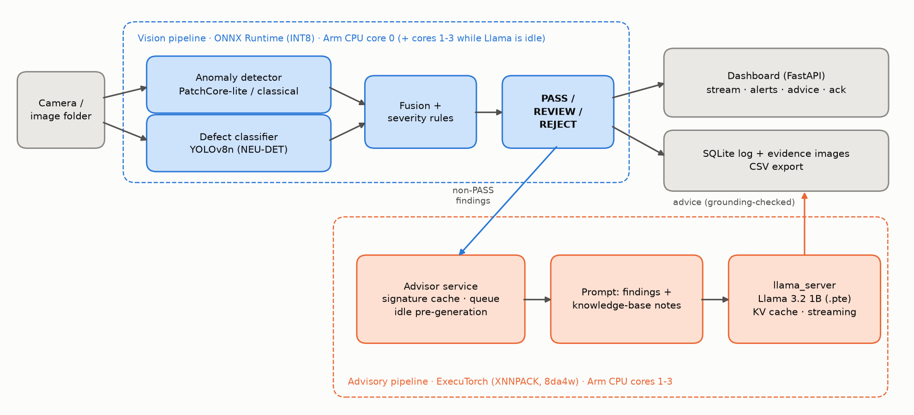
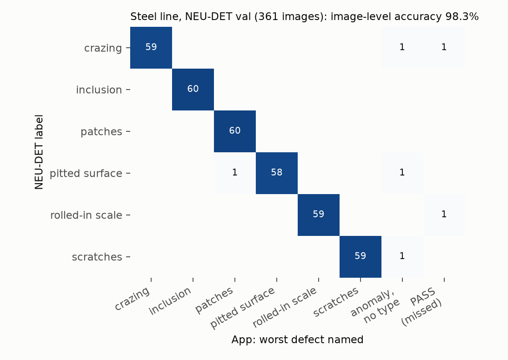
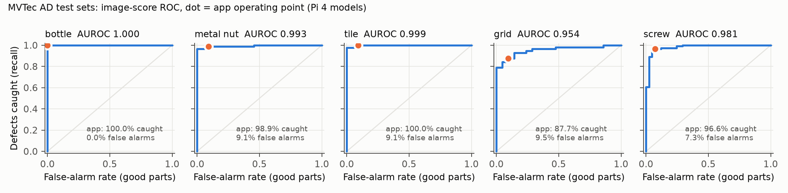

## Summary

EdgeQC is a real-time visual quality-control station that runs entirely on an Arm CPU, with no cloud and no
accelerator. A camera frame goes through two vision models (a YOLOv8n defect classifier and a PatchCore anomaly
detector), a fusion and severity stage decides **PASS / REVIEW / REJECT**, and a **Llama 3.2 1B Instruct** model
running through **ExecuTorch** explains the defect to the operator (likely cause, immediate action, process check).
Every inspection is logged with its evidence image; the operator works from a web dashboard.

The target device is a **Raspberry Pi 4 Model B (4 GB, 4x Cortex-A72 @ 1.5 GHz, 64-bit Debian), CPU only**, an
"Arm-based Linux device" in the problem statement's hardware list. It is the weakest platform on that list: the A72
lacks the Armv8.2 dot-product instructions that ExecuTorch's fastest 4-bit kernels need, so every design choice
below was measured on the device itself.

| Result on the Raspberry Pi 4 (no accelerator) | Value |
|---|---|
| Steel line (NEU-DET val, 361 images): correct defect type named | **98.3%** |
| MVTec AD, 5 products: defects caught / good parts flagged | **87.7-100% / 0-9.5%** (bottle 100/0, screw 96.6/7.3) |
| Throughput | steel **5 FPS** (2 FPS while Llama writes); MVTec 3.4-4.4 FPS |
| Llama 3.2 1B advice (ExecuTorch, 8da4w) | 26 s median for a new defect type, first words after 6-12 s, **instant** for a type seen before |
| Advice quality (20 scripted cases) | 0 invented numbers, 0 wrong defect types, 0 contradicted verdicts; mean 4.15 / 5 |
| Peak memory, vision + Llama | **1.05-1.15 GB** of 4 GB |

## 1. Problem and requirements

Problem Statement 5 asks for real-time industrial defect detection with a quality-control assistant on an Arm edge
device, where a Llama-family model runs through ExecuTorch on the Arm CPU. From the mentoring session we took five
evaluation lenses and built evidence for each: **detection quality** (misses and false alarms, not only AUROC),
**real-time operation on the device**, **useful, grounded advice**, **operator experience** (clear alerts, easy log),
and **rigour** (separately documented vision and LLM runtimes, honest limits).

Two practical constraints shaped the design. First, factories rarely have many images of each defect type, and new
defect types appear; a pure supervised detector cannot flag what it never saw. Second, a 1B-parameter LLM on four
A72 cores takes tens of seconds per reply, so it must never sit on the inspection path.

## 2. System design



**Vision pipeline (ONNX Runtime, Arm CPU).**

- **Defect classifier**: YOLOv8n trained on NEU-DET (six hot-rolled steel defect types), INT8, 256 px input. Per-class
  confidence thresholds (crazing 0.15, rolled-in scale 0.20, others 0.35) came from a label audit (section 5.1).
- **Anomaly detector**: PatchCore-lite, ResNet-18 layer2+3 features compared with a coreset memory bank of good-part
  patches (k-NN distance). It is trained on good parts only, so it flags defects it has never seen. We fuse feature
  extraction, an optional PCA-128 projection and the k-NN into one INT8 ONNX graph per product. For the steel line,
  where NEU has no defect-free images, a classical OpenCV detector (background subtraction + robust z-score) plays
  this role.
- **Fusion and severity**: anomaly regions that overlap a classifier box take its type; the others become typed
  anomalies by shape (`anomaly_linear` / `anomaly_spot` / `anomaly_area`). A rule table sets severity from the
  defect class, its area and anomaly strength (MINOR / MAJOR / CRITICAL), and the verdict follows (MINOR → REVIEW,
  otherwise REJECT). The verdict is decided here, deterministically, and never by the LLM.

**Advisory pipeline (ExecuTorch, Arm CPU).** Llama 3.2 1B Instruct is exported to an ExecuTorch program (`.pte`,
8-bit dynamic activations / 4-bit grouped weights, "8da4w", XNNPACK delegate, 1,024-token context, 803 MB). It is
served by `llama_server`, our small C++ program on top of ExecuTorch's LLM runner (`native/llama_server.cpp`). It
keeps the model resident, streams tokens, and keeps two levels of KV cache (section 4.2). The model receives
**structured findings, not pixels**: product, verdict, anomaly score, and per defect its type, severity, area and
location zone, plus **reference notes** for the detected classes from a defect knowledge base
(`configs/defect_kb.yaml`: description, causes, actions). It replies in exactly three lines (`Cause:`, `Action:`,
`Check:`).

A cheap **grounding check** rejects replies that break the format, copy raw fields, or never name a detected defect
type. A rejected reply is replaced by the deterministic rule-based advisor, which is also the fallback if the model
is missing or times out.

**Log entry.** The mentoring slides suggest that Llama "writes the log entry". We measured that and chose to write
the `Log:` line in code from the same findings (verdict, severity, type, zone, score). That line holds only facts
the app already has: generating it cost ~20% of the decoded tokens (−22% reply time on the Pi), and in one test the
model dropped the severity. The log is now exact, and the model's time goes to the cause and actions, the part only
it can write.

**Application.** One Python process (`src/edgeqc/app.py`) runs the vision loop. An asynchronous advisor service
caches advice per **defect signature** (product, verdict, worst severity per class): a repeat of a known defect type
shows Llama advice instantly with its own log line. Replies are stored on disk across restarts, and advice is
pre-generated while the line is idle. Overflowing requests get rule advice at once. A FastAPI dashboard shows the
live annotated stream (boxes, heatmap, verdict colour), the advice as it is written, an acknowledge button, the
inspection log, and CSV export. Inspections go to SQLite (WAL) with the evidence image.

## 3. Datasets and training

| Dataset | Use | Split |
|---|---|---|
| NEU-DET (6 steel defect classes, 200x200 grayscale) | YOLOv8n classifier | 1,439 train / 361 val |
| MVTec AD: bottle, metal_nut, tile, grid, screw | PatchCore per product | train = good only; 10% of good train images held out for calibration; full test sets for evaluation |

YOLOv8n was trained on the BITS Hyderabad HPC (A100, 100 epochs, 4 min 42 s); a 3-seed recipe study ran on Kaggle
(2x T4). PatchCore banks were built on the HPC and, for the Pi-size models, on a Mac (MPS), in about 30 s per model.
INT8: YOLO with static per-channel quantisation (detection head kept FP32); PatchCore with the backbone
convolutions quantised and the k-NN kept FP32.

**Thresholds.** Each PatchCore model is calibrated on its held-out good images only: max score x 1.05. The image
score is the maximum of the Gaussian-smoothed anomaly heatmap. A per-product sensitivity factor
(`threshold_scale`, 0.87-1.0) was then chosen on the test set for ≤ 10% false alarms. We report this openly
(section 7), together with the holdout-only operating points.

## 4. Implementation on the Arm CPU

### 4.1 Vision runtime

ONNX Runtime CPU (MLAS / NEON kernels) runs the INT8 models. The Pi 4 uses smaller PatchCore models
(`configs/devices/pi4.yaml` selects them per product): 224 px / 2,048-patch banks for bottle, metal_nut and tile,
and 256-288 px / 4,096 with **PCA-128** for grid and screw. We profiled the fused graph on one A72 core: the k-NN
matmul took 42% of the time, so projecting the 384-dimensional patch features to 128 (fitted on good patches,
applied as a 1x1 convolution inside the graph) cut the k-NN cost by about 3x. The saved time bought back resolution,
and screw AUROC went from 0.938 to 0.965 at the same latency.

We also exported the vision models to ExecuTorch (XNNPACK). Accuracy was identical, but it ran 24% slower than ONNX
Runtime on the Pi 4 (313 vs 252 ms): the 3x3 average pool and the min-over-bank reduction are not XNNPACK-delegated
and fall back to single-threaded portable kernels. ExecuTorch therefore serves the LLM, and the app keeps an
ExecuTorch vision backend as an option.

### 4.2 LLM runtime (ExecuTorch)

| Step | Effect on the Pi 4 |
|---|---|
| Resident `llama_server` instead of re-launching `llama_main` | no model reload per request (35 s warm-up once) |
| Static-prefix KV cache (system prompt + worked example, ~75% of the prompt) prefilled once | reply 57-82 s → 26-38 s |
| Prompt ordered as notes-before-findings + second KV-cache level per defect class | first words 11 → 6 s on same-class repeats |
| Log line written by code, pixel boxes dropped from the prompt | −22% reply time |
| Token streaming to the dashboard | operator sees text after 6-12 s instead of a blank wait |
| Advice cache per defect signature (+ disk persistence, idle pre-generation) | known defect types: instant |
| Output-vocabulary pruning (128k → 24k tokens) | decode −12% but reply time within noise; optional, not default |

### 4.3 Scheduling vision and Llama on four cores

Running both with all-core thread pools stalled both: 3 FPS and 74-90 s per reply, because XNNPACK synchronises its
threads on every operator and one preempted thread holds up the operator. We pin vision to core 0 and Llama to cores
1-3. While Llama is idle, vision switches to a second 4-thread ONNX Runtime session ("boost"). A separate output
thread on cores 1-3 renders the overlay and encodes the JPEG, so the vision core only inspects.

## 5. Results

All numbers are app verdicts from the deployed configuration unless stated. Raw data: `docs/RESULTS.md`,
`runs/report_bench/`, figures in `docs/figures/`.

### 5.1 Detection quality

**Steel (NEU-DET val, 361 images).** Box mAP@0.5 of the deployed INT8 256 px model is 0.707 (FP32 PyTorch: 0.738).
Crazing and rolled-in scale are the weak classes, as in the literature (≈ 0.5 AP). A label audit showed why: crazing
is a texture over the whole image, yet each image has 2-3 arbitrary boxes, so box confidence stays low even on
training data. The model rarely *confuses* classes. Lowering only those two classes' confidence thresholds raised
image-level accuracy from 86.7% to 97.5%. The full pipeline names the correct type for **98.3%** of images:

{width=70%}

Architecture and recipe sweeps (YOLOv8s, YOLO11n, 640 px, 200 epochs, a literature-derived augmentation recipe
over 3 seeds) gave no gain beyond seed noise: seed alone moves mAP@0.5 by 2.8 points.

**MVTec AD (full test sets, Pi models).**

| Product | Image AUROC | Defects caught | Good parts flagged | Holdout-only threshold (scale 1.0) |
|---|---|---|---|---|
| bottle | 1.000 | 100% (63) | 0.0% (20) | 100% / 0% |
| metal_nut | 0.993 | 98.9% (93) | 9.1% (22) | 96.8% / 4.5% |
| tile | 0.999 | 100% (84) | 9.1% (33) | 91.7% / 0% |
| grid | 0.954 | 87.7% (57) | 9.5% (21) | 73.7% / 0% |
| screw | 0.981 | 96.6% (119) | 7.3% (41) | 52.1% / 0% |



Using the smoothed-heatmap maximum as the image score, instead of the single largest patch distance, raised AUROC
on grid (0.911 → 0.954) and screw (0.965 → 0.981) at no extra compute.

**Ablation: value of each part of the hybrid** (`scripts/ablation.py`, desktop models):

| Steel line (NEU val, 361 defective images) | Defects caught | Correct type named |
|---|---|---|
| **Hybrid: classifier + classical anomaly (deployed)** | **99.4%** | **98.3%** |
| Classifier only | 98.6% | 98.3% |
| Anomaly detector only | 71.5% | 0% (untyped) |

| MVTec, caught / good flagged | bottle | metal_nut | tile | grid | screw |
|---|---|---|---|---|---|
| **PatchCore (deployed)** | **100 / 0%** | **98.9 / 9.1%** | **100 / 9.1%** | **80.7 / 4.8%** | **95.0 / 4.9%** |
| Classical OpenCV detector | 96.8 / 100% | 100 / 100% | 2.4 / 0% | 0 / 0% | 100 / 100% |

On NEU the anomaly stage adds only 0.8 points of recall (3 images the classifier missed), because the classifier
was trained on all six defect types present. Its role is the defects a classifier has never seen, which NEU cannot
measure; MVTec is that case, where no defect type is known in advance. There a learned anomaly model is essential:
the classical detector either flags every part or none.

### 5.2 Real-time performance on the Raspberry Pi 4

Per-stage latency of one inspection, median ms (vision on one core / four-core boost):

| Profile | Anomaly | Classifier | Fusion + severity | Overlay + JPEG\* | Log | Total |
|---|---|---|---|---|---|---|
| steel | 16.8 | 198 / **92** | 0.1 | 4.4 | 0.6 | 221 / 115 |
| bottle | 383 / **132** | - | 0.1 | 48 | 0.5 | 470 / 219 |
| screw | 563 / **198** | - | 0.1 | 48 | 0.7 | 642 / 277 |

\*On the output thread in the app, not on the vision core. Image decode from disk (1-42 ms) is replaced by a camera
grabber thread in live use.

| Full app, 900 frames, web UI on | steel | screw |
|---|---|---|
| Throughput while Llama is idle / generating | 5.0 / 2.0 FPS | 3.4 / 1.7 FPS |
| Mean over a run with a cold advice cache | 2.1 FPS | 2.5 FPS |
| Peak memory (PSS): app + llama_server | **1.05 GB** (149 MB + 898 MB) | **1.15 GB** (307 MB + 840 MB) |
| Lowest free memory / swap used | 1.59 GB / 5 MB | 1.46 GB / 5 MB |

All Pi runs were made **without a heatsink fan**: the SoC sat at 80-87 °C and soft-throttled
(`vcgencmd get_throttled` = 0xe0008). These figures are therefore lower bounds.

### 5.3 Advice quality and latency

Twenty scripted findings cover all 10 knowledge-base classes (6 steel types, crack, 3 untyped anomalies), single
and two-defect cases, REVIEW and REJECT (`scripts/eval_advisor.py`):

| Of 20 replies | Llama 3.2 1B | Rule baseline |
|---|---|---|
| Correct three-line format | 20 | 20 |
| Pass the grounding check | 19 | 20 |
| Name the worst defect type | 15 | 20 |
| Cause restates a knowledge-base cause / action restates a KB action | 14 / 20 | 20 / 20 |
| Name an undetected defect type / invent a number / contradict the verdict | **0 / 0 / 0** | 0 / 0 / 0 |
| Rating 1-5 against the knowledge base (rated by an AI assistant, not a domain expert) | **4.15** (none below 3) | template |

Example (case 3, inclusion, REJECT): *"Cause: Possible slag entrapment during casting, leading to non-metallic
inclusion particles. Action: Mark the affected area and cut it out, then inform the melt shop of the heat number.
Check: Check the ladle for proper practice and inspect the tundish refractory for wear."*

Latency (no vision load): median reply 25.7 s, first word 11.6 s (5.9 s when the class notes are cached), 3.8
tokens/s decode, about 49 tokens per reply. With vision running, a first-time reply takes 46-83 s, and repeats are
instant. Typical weaknesses: the cause line sometimes restates the defect description, and in two-defect cases it
can follow the less severe defect.

Two problems found by these runs were fixed: the grounding check now accepts word stems ("a patch" for
*patches*). With greedy decoding, a rejected reply is no longer retried, because it repeats exactly; on the screw
line this cut wasted Llama time by two-thirds and raised mean throughput from 1.6 to 2.5 FPS.

## 6. What we tried and did not adopt

| Idea | Outcome |
|---|---|
| Bigger / newer detectors (YOLOv8s, YOLO11n, 640 px), 200 epochs, augmentation recipe (3 seeds) | within seed noise; 2-4x compute |
| ExecuTorch for the vision models | same accuracy, 24% slower on the A72 (non-delegated ops) |
| Larger PatchCore banks (8,192) / rotation-augmented bank for screw | +3 pt recall for +60% latency / worse (0.938 vs 0.972) |
| Foreground crop for screw | the part already fills ~87% of the frame |
| Output-vocabulary pruning of Llama | decode −12%, end-to-end within noise; kept optional |
| Prompt-lookup speculative decoding | on the A72 prefill is only ~3x decode speed, so verification costs too much |
| Raw maximum patch distance as image score | noisier than the smoothed heatmap (replaced) |

## 7. Limitations

- **Thresholds use test labels.** The per-product sensitivity factor was chosen on the MVTec test sets for ≤ 10%
  false alarms. The good test sets are small (20-41 images), so one image moves the false-alarm rate by 2.4-5
  points. The holdout-only operating points (table in 5.1) are lower for screw and grid.
- **No defect-free steel images.** NEU-DET contains only defective images, so the false-reject rate on good steel
  is unmeasured.
- **Grid** is the weakest product (87.7% caught at 9.5% false alarms).
- **Advice quality** was rated by an AI assistant against the knowledge base, not by a quality engineer.
  Twenty cases is a small sample.
- **Llama latency** is tens of seconds for a new defect type on the A72. The cache makes repeats instant, but
  idle pre-generation can delay a real first-time defect by up to one reply.
- **Live camera.** The measurements use image-folder "virtual conveyors". The latest-frame camera grabber is
  implemented but was not benchmarked here.
- **Thermals.** Without a fan the Pi throttles. Performance numbers are pessimistic.
- **Hailo backend** is implemented but untested (no AI HAT+, which needs a Pi 5).

## 8. Future work

Run on a Raspberry Pi 5 (Cortex-A76 with dot-product: roughly 2-3x faster Llama with the same code) and on the AI
HAT+ (vision on HailoRT, all four cores for Llama). Collect defect-free steel images and a larger good-part set to
calibrate thresholds without test labels. Try STFPM for grid. Fine-tune the 1B model (LoRA) on knowledge-base
derived advice. Let the operator ask follow-up questions and get shift summaries from the log. Feed operator
overrides back as training data.

## 9. Reproducibility

```bash
git clone <repo> && cd edgeqc && python3 -m venv .venv && .venv/bin/pip install -e '.[dev]'
.venv/bin/python -m pytest -q                                  # 28 tests, no models needed
scripts/demo.sh steel                                          # dashboard on :8000 (Pi 4 profile auto-selected)
python -m edgeqc.app --config configs/profiles/mvtec_screw.yaml --device configs/devices/pi4.yaml
scripts/pi_report_bench.sh                                     # sections 5.2-5.3 on a Pi
python scripts/report_figures.py --device configs/devices/pi4.yaml   # figures in docs/figures
```

The deployed INT8 vision models are in the repository. The Llama `.pte` is built with `docs/EXECUTORCH_LLAMA.md`
(Llama 3.2 licence acceptance needed). Without it the app runs with the rule-based advisor. Licences: MVTec AD
CC BY-NC-SA 4.0, Llama 3.2 Community License, Ultralytics YOLO AGPL-3.0. Sources for the design choices are in
`docs/LITERATURE.md`.
